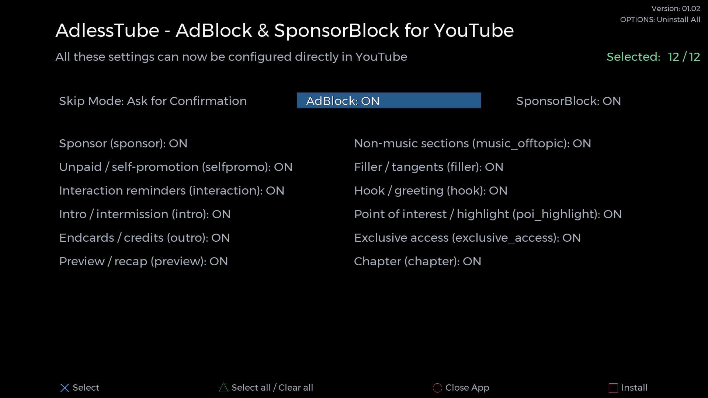

# AdlessTube - AdBlock & SponsorBlock Installer

A PS4 homebrew app for managing the AdlessTube YouTube plugin, including installation, updates, and SponsorBlock settings.

Our PS4 Youtube ad block plugin is compatible with: YouTube v02.32 from pkg-zone.com (CUSA01015)

For more information about AdlessTube - AdBlock & SponsorBlock for Youtube, visit our [GitHub page](https://github.com/FourZeroCode/ps4_yt_adsponsorblock).

## Features
Block ads and sponsor segments on YouTube

- Enable/Disable AdBlock
- Enable/Disable SponsorBlock
- Configure all 12 SponsorBlock categories.
- Choose **Auto Skip**, **Silent Auto Skip** or **Ask for Confirmation** for segments.
- Save settings to `/data/youtube/config.json`.
- Downloads the latest AdlessTube from [GitHub Releases](https://github.com/FourZeroCode/ps4_yt_adsponsorblock/releases).
- Install/update the PRX and manage its GoldHEN `plugins.ini` entry.
- Uninstall the managed plugin and SponsorBlock configuration.



## Build (Windows)

1. Install the [OpenOrbis PS4 Toolchain](https://github.com/OpenOrbis/OpenOrbis-PS4-Toolchain).
2. Make sure `OO_PS4_TOOLCHAIN` points to your toolchain installation.
3. Keep the `_common` folder beside `SponsorBlockConfig.sln`.
4. From `SponsorBlockConfig/SponsorBlockConfig`, run:

   ```bat
   .\build_standalone.bat .\x64\Debug "SponsorBlockConfig" "..\\"
   ```

## Credits

- **[OpenOrbis PS4 Toolchain](https://github.com/OpenOrbis/OpenOrbis-PS4-Toolchain)** — PS4 homebrew toolchain, headers, libraries, and build tools.

- **[SponsorBlock](https://github.com/ajayyy/SponsorBlock)** — the community project and category IDs this app configures.

## Disclaimer

This is an unofficial homebrew project and is not affiliated with or endorsed by SponsorBlock, or YouTube. Use at your own risk.